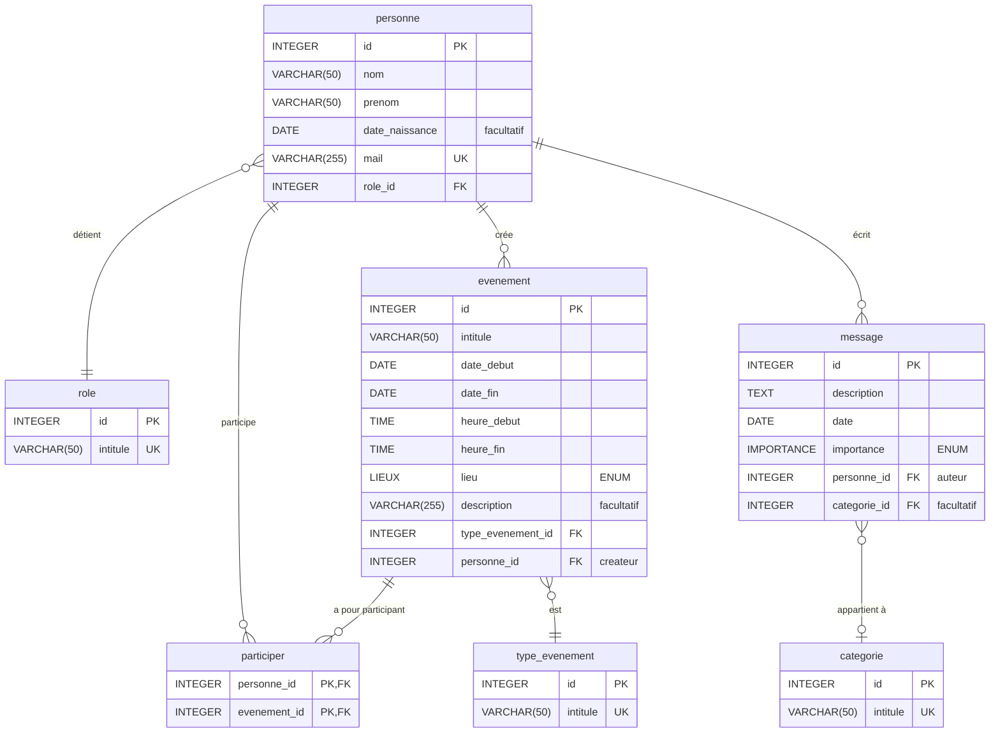

# Schéma MLD Vi'Assist - V1
## Lecture des liens
 
| Symbole | Signification |
| --- | --- |
| `\|\|` | exactement un |
| `\|o` | zéro ou un |
| `o{` | zéro ou plusieurs |
| `\|{` | un ou plusieurs |
 
Exemple : `categorie |o--o{ message : "classe"` se lit « un message est classé dans zéro ou une catégorie, et une catégorie classe zéro ou plusieurs messages ».

## Schéma
